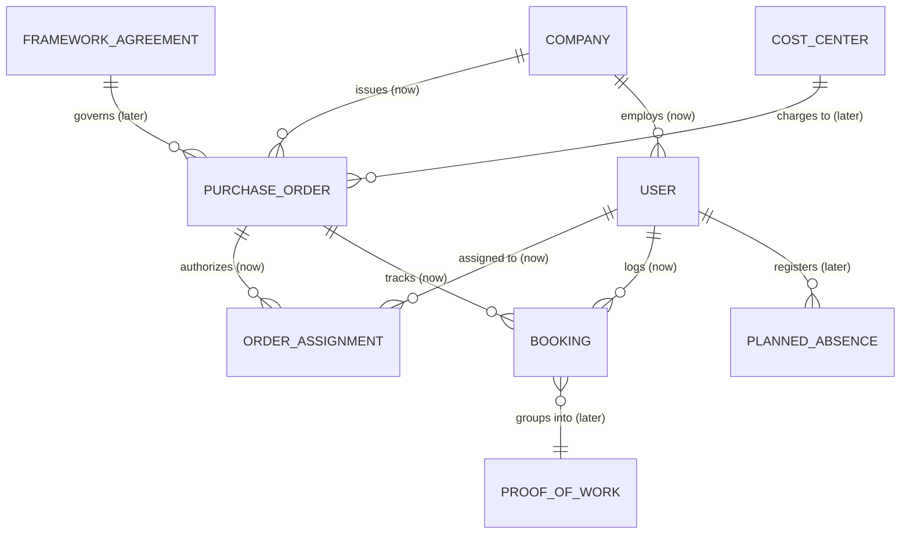

# Domain model

## Glossary

| Term | German | Meaning |
|---|---|---|
| **Purchase Order** | *Bestellung* | The client's formal order with a scope, period, and budget in Person-Days (PD). Every booking belongs to one order. |
| **Person-Day (PD)** | *Personentag (PT)* | Agreed unit of effort and billing (default: 8.0 hours). Configurable per order based on supplier kickoff agreements. |
| **Time Booking** | *Buchung* | A record of working time logged against an order with deliverable descriptions. |
| **Burn Rate** | *Verbrauchsrate* | The pace at which Person-Days are consumed per calendar week. |
| **Reorder Radar** | *Bestell-Vorwarnung* | The projected calendar week of budget exhaustion minus purchasing lead time (default: 4 weeks). |
| **Proof of Work** | *Leistungsnachweis* | Monthly aggregation of approved bookings submitted to client finance for invoice verification. |
| **Working Time Act** | *Arbeitszeitgesetz (ArbZG)* | German law restricting working time (max 10 hours/day, mandatory 11-hour rest periods). |
| **Calendar Week (CW)** | *Kalenderwoche (KW)* | Standard German corporate planning timeline (KW 1 – KW 52). |
| **Supplier** | *Dienstleister* | The external consulting agency delivering the services under contract. |

## Entity relationship diagram

Entities we **build now** are marked `(now)`, entities of the **next expansion stage** `(later)`.

## Entity Details

### Built Now `(now)`

* **`Company`**: Represents either the client enterprise or an external vendor/supplier agency.
* **`User`**: Has a defined role (`project_lead`, `purchasing`, `consultant`) and belongs to a `Company`.
* **`PurchaseOrder`**:
  * `order_number`: Formal client order reference (e.g. `PO-4500012345`).
  * `title` & `description`: Project scope and title.
  * `total_budget_days`: Total contracted person-days (e.g. `140.0`).
  * `daily_hours_per_day`: Configurable conversion factor (default: `8.0` hours = `1.0` PD).
  * `max_daily_hours`: Configurable German ArbZG threshold (default: `10.0` hours).
  * `reorder_lead_weeks`: Configurable purchasing lead-time warning window (default: `4` weeks).
  * `federal_state`: German federal state for statutory holiday blackouts (e.g. `BY` for Bavaria).
  * `start_date` & `end_date`: Delivery timeframe.
* **`OrderAssignment`**: Explicit authorization linking a consultant to an order (consultants only see and book on assigned orders).
* **`Booking`**:
  * `order_id`: Assigned purchase order.
  * `user_id`: Consultant submitting the booking.
  * `date`: Working day.
  * `hours`: Duration worked.
  * `description`: Deliverable or work package summary.
  * `status`: `submitted`, `approved`, or `rejected`.
  * `rejection_reason`: Explanation if rejected by the Project Lead.

### Next Expansion Stage `(later)`

* **`FrameworkAgreement` (*Rahmenvertrag*)**: Multi-order master agreement with allocated umbrella budget.
* **`CostCenter / PSPElement`**: SAP accounting structures for cross-departmental cost allocation.
* **`ProofOfWork` (*Leistungsnachweis*)**: Formal monthly sign-off dossier for invoice matching.
* **`PlannedAbsence`**: Planned vacations and public holiday blackouts for predictive burn modeling.

## Calculation & Business Rules

1. **Person-Day Conversion:**
   $$\text{Person-Days} = \frac{\text{Hours}}{\text{daily\_hours\_per\_day}}$$
2. **Consumed Budget:**
   $$\text{Consumed Budget (PD)} = \sum_{\text{submitted, approved}} \text{Person-Days}$$
3. **Remaining Budget:**
   $$\text{Remaining Budget (PD)} = \text{total\_budget\_days} - \text{Consumed Budget}$$
4. **Pace / Burn Rate:**
   $$\text{Weekly Burn Rate} = \frac{\text{Consumed Budget (PD)}}{\text{Elapsed Project Weeks}}$$
5. **Projected Depletion (Calendar Week):**
   $$\text{Remaining Weeks} = \frac{\text{Remaining Budget (PD)}}{\text{Weekly Burn Rate}}$$
   The forecast calculates the target Calendar Week (KW), skipping German public holidays and Christmas freeze periods.
6. **Reorder Alarm Trigger:**
   If $\text{Projected Depletion Date} - \text{Current Date} \le \text{reorder\_lead\_weeks} \times 7\text{ days}$, the system raises an automated warning for Purchasing and the Project Lead.
7. **German Working Time Act (*ArbZG*) Guardrail:**
   Any booking with $\text{Hours} > \text{max\_daily\_hours}$ (default: 10.0h) is rejected on the server with a descriptive compliance error.
